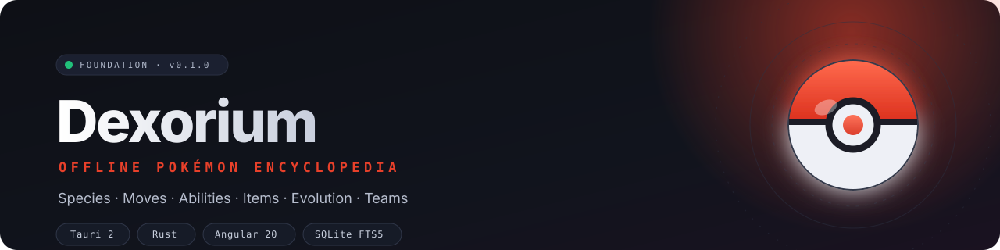
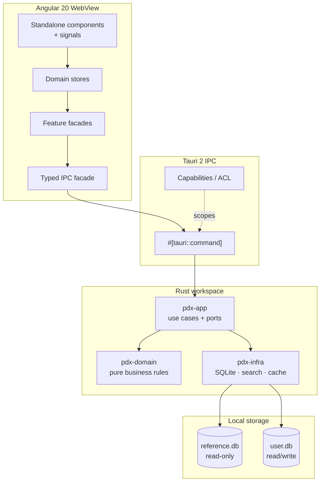

<div align="center">



# Dexorium

**A fast, fully offline Pokémon desktop encyclopedia for players, collectors and competitive trainers.**

[](https://tauri.app)
[](https://www.rust-lang.org)
[](https://angular.dev)
[](https://www.sqlite.org/fts5.html)
[](./LICENSE)
[](#-project-status)
[](https://github.com/Martzcode/Dexorium/actions/workflows/ci.yml)
[](#-platforms)

[Why Dexorium](#-why-dexorium) ·
[Features](#-features) ·
[Tech stack](#-tech-stack) ·
[Architecture](#-architecture) ·
[Getting started](#-getting-started) ·
[Roadmap](#-roadmap) ·
[Contributing](#-contributing)

</div>

---

## 🌐 What is Dexorium?

**Dexorium** is a native desktop Pokédex and Pokémon reference application that works with **zero internet connection**. Species, forms, base stats, types, abilities, moves, items, evolution chains, learnsets and competitive tools are bundled locally and queried through an embedded SQLite database: no account, no ads, no telemetry and no silent network calls.

It is built for people who need reliable data **right now**: at a tournament with unreliable Wi-Fi, on a plane, in a venue basement, or simply when the major reference wikis are slow. The interface targets professional-tool ergonomics: instant search, full keyboard navigation, a command palette, cross-linked pages and a light/dark theme that follows the OS.

> **Project status:** Phase 0: technical foundation. The Tauri shell, layered Rust workspace, typed IPC bridge and Angular 20 interface are in place. The Pokédex dataset and feature modules are actively being built. See the [roadmap](#-roadmap).

---

## 💡 Why Dexorium?

| Problem                                           | Dexorium's answer                                          |
| ------------------------------------------------- | ---------------------------------------------------------- |
| Reference wikis need a connection and are slow    | Complete local dataset, indexed SQLite queries             |
| Mobile Pokédex apps are ad-supported or abandoned | Native desktop app, no ads, versioned data                 |
| Data is scattered across five different sources   | One unified, cross-linked data model                       |
| Competitive tools live outside the Pokédex        | Damage calculator, team builder and type coverage built in |
| Serious living-dex tracking is an afterthought    | Collection profiles, filters and export                    |

**Design goals**

- **Offline absolute.** The full database ships with the binary. No network dependency at runtime.
- **Native performance.** Cold start below 1.5 s, search over 1,000+ species and 900+ moves in under 50 ms.
- **Data depth.** Moves, abilities, items, encounters, evolution conditions, learnsets per version group and competitive calculators.
- **Accessibility.** WCAG 2.1 AA target, full keyboard navigation, visible focus and reduced-motion support.
- **Auditability.** Every dataset field can be traced back to its source and game version.
- **Privacy first.** Local user data only. No account, no analytics, no telemetry.

---

## ✨ Features

### Available now: foundation

- [x] Native **Tauri 2** window with a strict Content Security Policy and a minimal ACL
- [x] **Angular 20** standalone shell, signals, zoneless change detection, lazy routes
- [x] **Transloco** internationalization with runtime FR/EN switching
- [x] Light / dark / system theme with persistence
- [x] Typed IPC facade over the Tauri bridge
- [x] Layered **Rust workspace**: `pdx-domain`, `pdx-app`, `pdx-infra`
- [x] Domain smoke tests and a clean dependency direction

### In progress: offline Pokédex MVP (v1.0)

- [ ] Embedded SQLite reference database with FTS5 search
- [ ] National and regional Pokédex with virtual scrolling
- [ ] Complete species pages: stats, types, abilities, forms, sprites, flavor text
- [ ] Evolution chains with structured conditions
- [ ] Learnsets filterable by version group and learn method
- [ ] Instant fuzzy search across French, English and Japanese names
- [ ] Multi-criteria filters: type, generation, stat ranges, abilities, flags
- [ ] Global command palette (`Ctrl/Cmd + K`)
- [ ] Favorites and recent views

### Planned

- [ ] Damage and stat calculators, speed tiers, type coverage (v1.2)
- [ ] Team builder with legality checks and Showdown import/export (v1.2)
- [ ] Encounter locations, items, abilities catalogues (v1.1 → v1.2)
- [ ] Collection profiles and living-dex tracking (v1.3)
- [ ] Signed data packs, custom themes and local API (v1.4 → v2.0)

---

## 🧰 Tech stack

| Layer         | Technology                                         | Role                                                             |
| ------------- | -------------------------------------------------- | ---------------------------------------------------------------- |
| Desktop shell | **Tauri 2**                                        | Native window, IPC, capabilities, signed installers              |
| Backend       | **Rust** (stable, edition 2024)                    | Native performance, predictable latency, memory safety           |
| Frontend      | **Angular 20**                                     | Standalone components, signals, zoneless, CDK                    |
| State         | **NgRx Signals**                                   | Reactive domain stores                                           |
| UI primitives | **Angular CDK** + custom design tokens             | Virtual scroll, overlays, accessibility without Material lock-in |
| Styling       | **SCSS** + CSS custom properties                   | Instant theming, no CSS-in-JS runtime                            |
| i18n          | **Transloco**                                      | Hot language switching and lazy dictionaries                     |
| Database      | **SQLite 3 + FTS5**                                | Embedded reference data and full-text search                     |
| IPC contract  | **Tauri commands** + typed TypeScript facade       | One thin command per use case                                    |
| Testing       | `cargo test`, Vitest, Testing Library, WebdriverIO | Unit, component and E2E coverage                                 |

---

## 🏗 Architecture



**Dependency rule:** `pdx-domain` ← `pdx-app` ← `pdx-infra` ← Tauri binary. The domain layer knows nothing about SQLite, Tauri or the file system.

**Storage split:** `reference.db` is replaced on dataset upgrades; `user.db` holds favourites, teams, notes and settings and is never touched by a dataset update. Cross-database references use stable slugs, not technical IDs.

---

## 📁 Project structure

```text
Dexorium/
├── assets/branding/               # README banner and brand assets
├── public/i18n/                   # en.json, fr.json
├── src/                           # Angular application
│   ├── app/
│   │   ├── core/                  # IPC, app info, i18n, theme
│   │   ├── features/              # Lazy-loaded feature areas
│   │   ├── layout/                # App shell, sidebar, top bar
│   │   ├── app.config.ts
│   │   └── app.routes.ts
│   └── styles/                    # Design tokens and global styles
├── src-tauri/                     # Rust workspace + Tauri configuration
│   ├── crates/
│   │   ├── pdx-domain/            # Entities and pure rules
│   │   ├── pdx-app/               # Use cases and ports
│   │   └── pdx-infra/             # SQLite, search, cache adapters
│   ├── src/
│   │   ├── commands/              # Thin Tauri commands
│   │   └── lib.rs
│   ├── capabilities/              # Tauri v2 ACL
│   └── tauri.conf.json
├── package.json
└── README.md
```

---

## 🏁 Getting started

### Prerequisites

- **Node.js** 20+ and npm
- **Rust** stable with Cargo
- **Tauri system dependencies:** see the [official prerequisites](https://tauri.app/start/prerequisites/)
  - Windows: WebView2 (bundled with Windows 10/11) and MSVC Build Tools
  - macOS: Xcode Command Line Tools
  - Linux: `libwebkit2gtk-4.1-dev`, `build-essential`, `libssl-dev`, `libayatana-appindicator3-dev`, `librsvg2-dev`

### Install

```bash
git clone https://github.com/Martzcode/Dexorium.git
cd Dexorium
npm install
```

### Run the Angular interface in a browser

```bash
npm run start
```

Useful for UI work. The Tauri IPC bridge is disabled in this mode, so the shell shows a **browser preview** status instead of the desktop runtime.

### Run the native desktop app

```bash
npm run desktop:dev
```

### Build the reference dataset

The SQLite reference database is **not committed** to the repository. It is
produced by the `pdx-dataset` crate from a pinned source snapshot (see
`tools/dataset/sources.lock.toml`):

```bash
# Fetch the pinned source snapshot (cached in ~/.cache/pdx-dataset)
cargo run --manifest-path src-tauri/Cargo.toml -p pdx-dataset --release -- fetch

# Build, validate the 14 rules, then install src-tauri/resources/reference.db
cargo run --manifest-path src-tauri/Cargo.toml -p pdx-dataset --release -- \
  release --version 2026.11.0 --install-resource
```

The application opens `reference.db` at startup (resource directory, then
`src-tauri/resources/`, then `DEXORIUM_REFERENCE_DB`). When the file is absent
it falls back to the small bundled fixture so the interface remains usable.
`reference.db` is read-only and replaced wholesale on dataset upgrades; user
data lives in a separate `user.db`.

### Build a production desktop bundle

```bash
npm run desktop:build
```

The installer is written to `src-tauri/target/release/bundle/` (MSI/NSIS on Windows, DMG on macOS, deb/rpm/AppImage on Linux).

### Useful scripts

| Command                 | Description                                     |
| ----------------------- | ----------------------------------------------- |
| `npm run start`         | Angular dev server on `http://localhost:4200`   |
| `npm run build`         | Production Angular build                        |
| `npm run desktop:dev`   | Tauri development app with hot reload           |
| `npm run desktop:build` | Production desktop bundle                       |
| `npm run check:rust`    | `cargo check` for the whole Rust workspace      |
| `npm run test:rust`     | Rust unit tests                                 |
| `npm run format`        | Format the repository with Prettier             |
| `npm run check`         | Format check + Angular build + Rust check/tests |

---

## 🖥 Platforms

| Platform    | Targets                                         |
| ----------- | ----------------------------------------------- |
| **Windows** | Windows 10+ x64 / ARM64 (MSI + NSIS)            |
| **macOS**   | macOS 12+ Intel / Apple Silicon (notarized DMG) |
| **Linux**   | deb, rpm, AppImage                              |

The Tauri 2 foundation also keeps a native mobile build possible in a later phase, but mobile is not a current priority.

---

## 🗺 Roadmap

| Milestone                     | Scope                                                                          | Status         |
| ----------------------------- | ------------------------------------------------------------------------------ | -------------- |
| **Phase 0: Foundation**       | Tauri shell, Rust workspace, IPC, Angular shell, themes, i18n                  | ✅ Done        |
| **v1.0: Offline Pokédex MVP** | Dataset, species pages, evolution, learnsets, search, filters, command palette | 🚧 In progress |
| **v1.1: Data & comfort**      | Abilities, items, saved filters, comparison, exports, shortcuts                | Planned        |
| **v1.2: Competitive toolkit** | Damage/stat calculators, team builder, coverage, encounters, Showdown I/O      | Planned        |
| **v1.3: Collection**          | Profiles, living dex, tags, notes, dashboard                                   | Planned        |
| **v1.4: Extensibility**       | Signed data packs, custom themes, diagnostics                                  | Planned        |
| **v2.0: Platform**            | Plugin system, local read-only API, companion CLI                              | Backlog        |

Detailed product specifications and the data-source annex are maintained privately during development and will be published alongside the first public release.

---

## 🔒 Privacy and offline guarantees

- No account, sign-up or cloud sync.
- No analytics, crash reporting or telemetry by default.
- No runtime network calls: the application is fully functional offline.
- User data stays in the local application data directory.
- Update checks, when added, will be **opt-in only**.

---

## ⚖️ Legal notice

Dexorium is an **unofficial, non-commercial reference tool**. It is not affiliated with, endorsed by or sponsored by Nintendo, Creatures Inc., GAME FREAK Inc. or The Pokémon Company.

Pokémon and Pokémon character names are trademarks of their respective owners. Official sprites and artwork are **not** distributed in the base binary; media packs are optional and user-provided where required by the applicable rights. The source code is licensed under the **GNU Affero General Public License v3.0**. See [LICENSE](./LICENSE) and [NOTICE](./NOTICE).

---

## 🤝 Contributing

If Dexorium is useful to you, **star the repository**; it helps the project reach other players and trainers.

---

## 📄 License

[AGPL-3.0-or-later](./LICENSE) © 2026 Martzcode

<div align="center">

**Built for trainers who play offline.**

</div>
